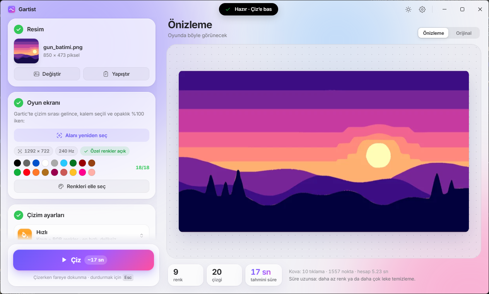
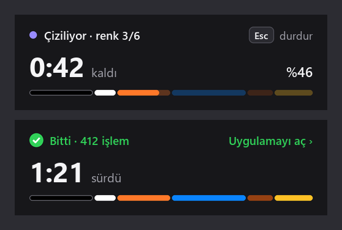
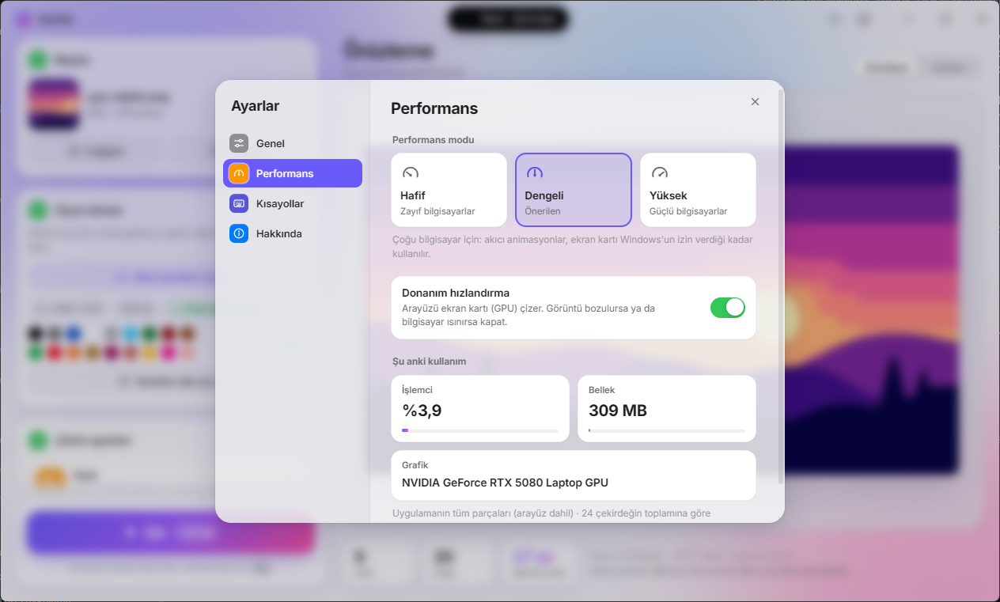
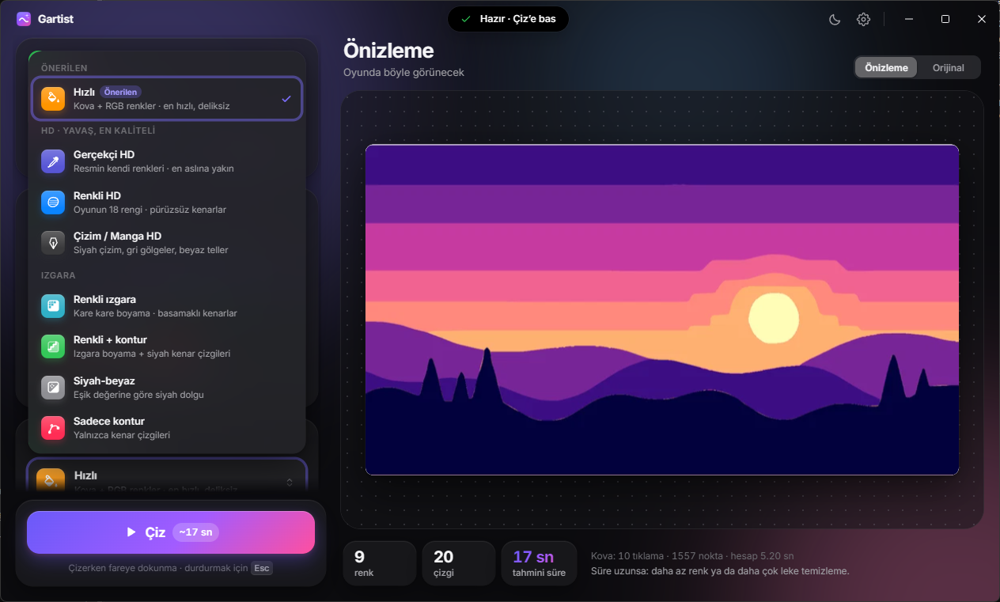
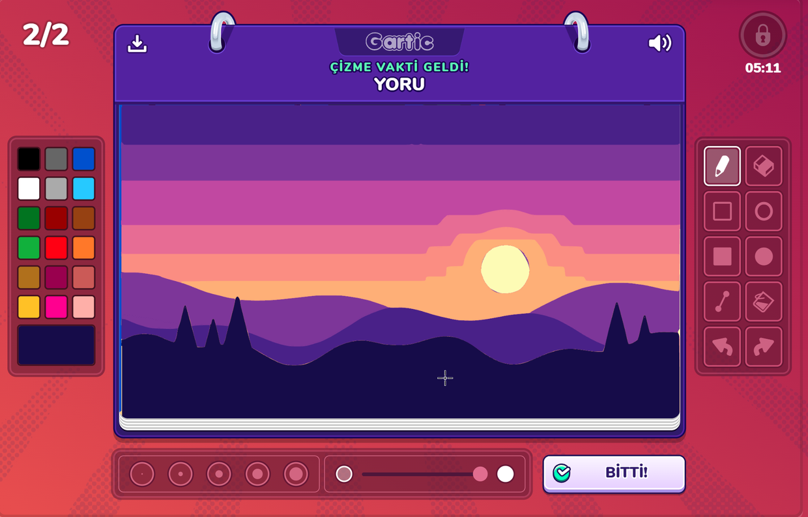
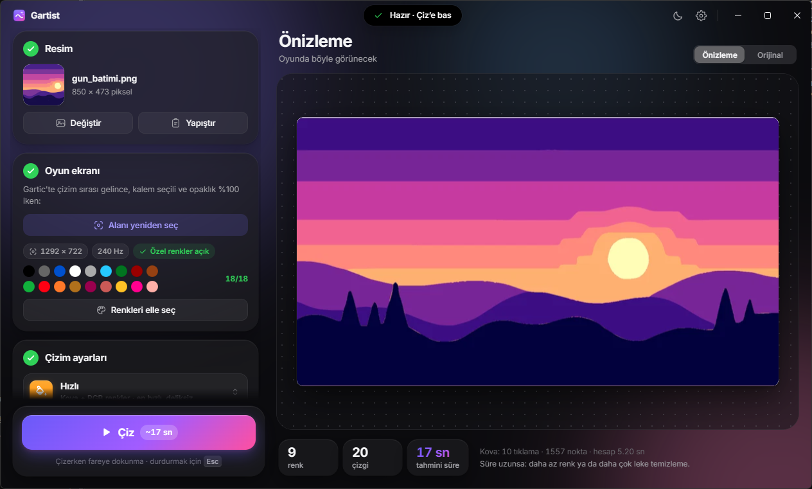

# Gartist

Bir resmi Gartic Phone'un çizim alanına **gerçek fare hareketleriyle** çizer. Oyuna eklenti ya da hile kodu
yüklemez; fareyi ve klavye kısayollarını senin yerine kullanır. *(Eski adı: Gartic Çizici.)*

### [⬇ Gartist'i indir (GarticCizici.exe)](https://github.com/unsalable/gartist-indir/releases/latest/download/GarticCizici.exe)

## Kurulum
1. Yukarıdaki bağlantıdan `GarticCizici.exe`'yi indir ve çift tıkla.
2. Uygulama kendini kurar; **Masaüstü** ve **Başlat menüsüne** "Gartist" kısayolu koyar.
3. Güncellemeler otomatik: yeni sürüm çıkınca uygulama onu kendiliğinden indirip kurar.

> Windows "bilgisayarınızı korudu" derse: **Ek bilgi → Yine de çalıştır** (exe imzalı değil, yalnızca ilk seferde).

Gereksinim: Windows 10 veya 11. Başka hiçbir şey kurman gerekmez.

## Kullanım
1. **Resim** — "Resim seç", pencereye sürükle-bırak ya da tarayıcıda resmi kopyalayıp **Ctrl+V**.
2. **Oyun ekranı** — Gartic'te çizim sırası gelince **"Çizim alanını seç"**, yeşil çerçeve doğruysa **Enter**.
3. **Çizim ayarları** — önizleme oyundaki sonucu ve tahmini süreyi gösterir. Önerilen mod: **Hızlı**.
4. **Çiz** — çizerken fareye dokunma; durdurmak için **Esc**.

Başlık çubuğunun ortasındaki ada her zaman sıradaki adımı söyler. Çizerken ekranın köşesindeki kart
**kaç saniye kaldığını**, yüzdeyi ve sıradaki rengi gösterir.

## Ayarlar
Sağ üstteki ⚙ düğmesinden:
- **Dil:** Türkçe / English.
- **Görünüm:** Açık / Koyu / Sistem.
- **Performans:** zayıf bilgisayarlar için *Hafif*, çoğu bilgisayar için *Dengeli*, güçlü bilgisayarlar için *Yüksek*;
  donanım hızlandırma (ekran kartı) açılıp kapatılabilir, uygulamanın anlık işlemci ve bellek kullanımı görünür.
- **Kısayollar:** resim açma, yapıştırma, alan seçme, çizme ve çizimi durdurma tuşları değiştirilebilir.

---
Bu depo yalnızca hazır sürümleri (exe) içerir; kaynak kod kapalıdır. Tüm hakları saklıdır.
Arkadaşlarınla eğlence için; herkese açık odalarda otomatik çizim oyun kurallarına aykırı sayılabilir.
